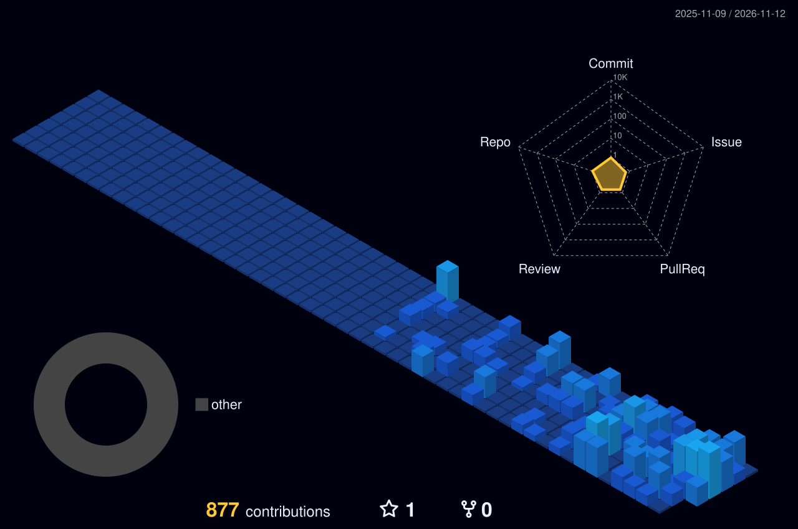

## Quests

| Quest | What it is | Realm |
|:--|:--|:--|
| [**AfroVoy**](https://afrovoy.com/) | Travel and hospitality marketplace | Web |
| [**Sevently**](https://sevently.netlify.app/) | Live website | Web |
| [**Kunle Ilori Diamond**](https://kunleiloridiamond.com/) | Live website | Web |
| [**Olivia's Portfolio**](https://olivia-liv.vercel.app/) | Personal developer portfolio | Web |
| [**Solufix Standard Cleaning**](https://solufixstandardcleaning.com/) | Live website for a cleaning company | Web |

## My contribution city

*Every commit raises another building, rebuilt automatically every day.*

**Always building, always learning.**

